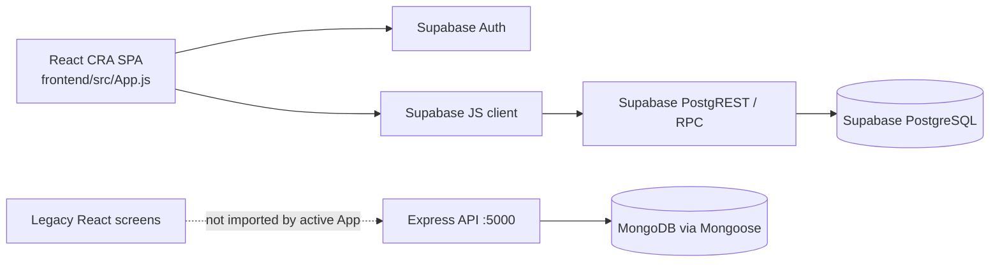
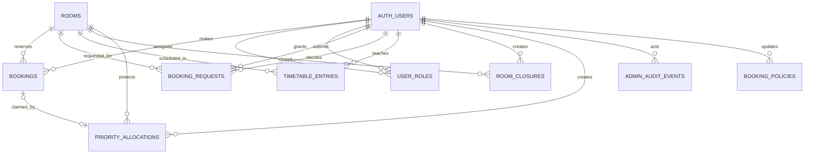
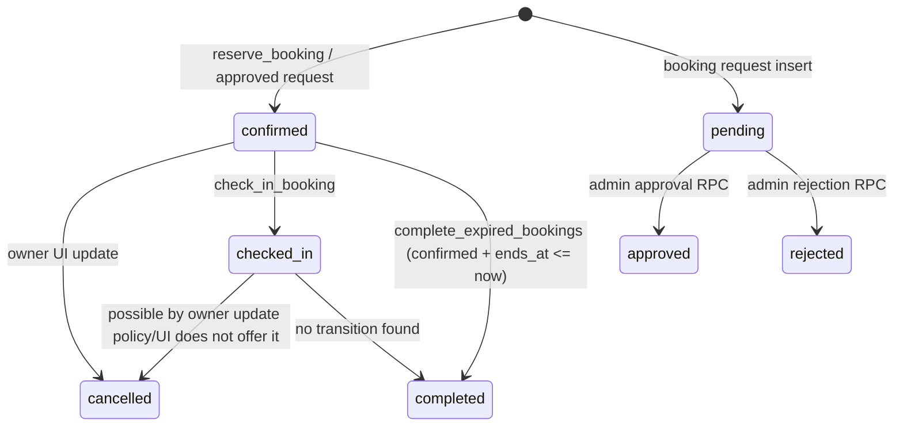
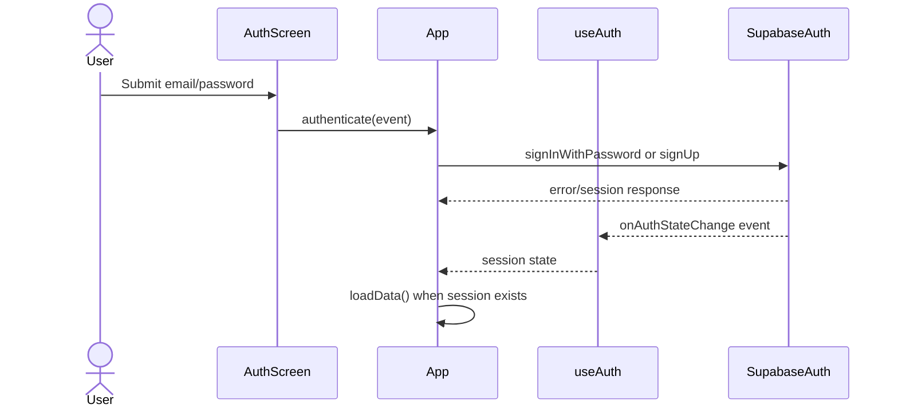
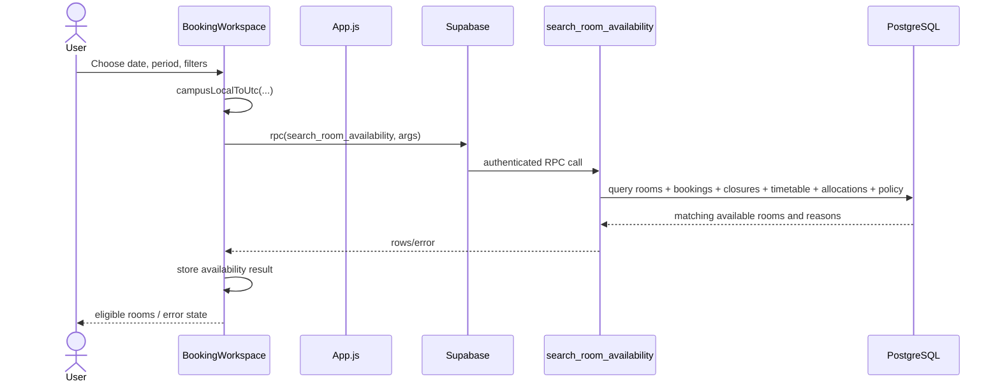
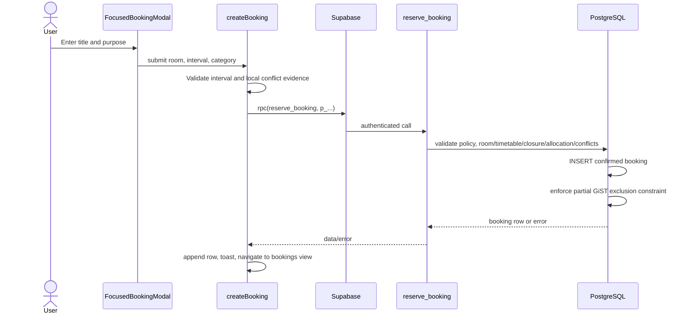
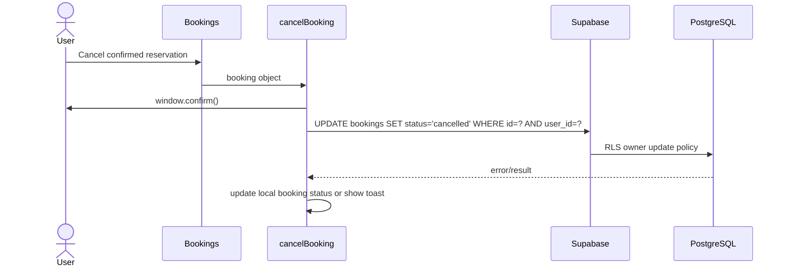

# Northstar — Classroom & Faculty Availability and Reservation Management

> **Evidence-based project guide.** This README describes the checked-out source and the connected Supabase schema observed during this investigation. It distinguishes code that exists from behavior that has not been verified in a live end-to-end run. It does not describe a target design as though it were implemented.

## Contents

1. [Executive overview](#1-executive-overview)
2. [Implementation status](#2-implementation-status)
3. [Architecture and technology](#3-architecture-and-technology)
4. [Repository map](#4-repository-map)
5. [Routes and application surfaces](#5-routes-and-application-surfaces)
6. [Authentication and authorization](#6-authentication-and-authorization)
7. [Database reference](#7-database-reference)
8. [Reservation workflow and conflict logic](#8-reservation-workflow-and-conflict-logic)
9. [Room, timetable, and faculty availability](#9-room-timetable-and-faculty-availability)
10. [Reservation lifecycle, QR, recurrence, and audit](#10-reservation-lifecycle-qr-recurrence-and-audit)
11. [API, RPC, and data-flow reference](#11-api-rpc-and-data-flow-reference)
12. [Algorithms and edge cases](#12-algorithms-and-edge-cases)
13. [Testing and quality](#13-testing-and-quality)
14. [Environment and deployment](#14-environment-and-deployment)
15. [Known issues and recommended work](#15-known-issues-and-recommended-work)
16. [Interview preparation](#16-interview-preparation)
17. [Architectural assessment](#17-architectural-assessment)

---

## 1. Executive overview

### One-line description

Northstar is a React campus-operations interface for finding rooms, placing time-bounded reservations, managing exceptional requests, and checking reservations in, backed by Supabase Postgres and Auth.

### Short overview

The active application in `frontend/src/App.js` is a single-page React application. A signed-in user can view room inventory, query availability for a campus-local interval, reserve a room, review and cancel their bookings, and check in using a confirmation code. The UI also has timetable, analytics, and admin surfaces for request decisions, room closures, room inventory, and user role assignment. Supabase is the data and authentication path for this active UI.

The repository also contains an older Express/MongoDB classroom timetable API and a set of React components that call it. These are separate from the current `App.js` screen tree: the active app does not import those legacy screens or route its current reservation operations through Express.

### Detailed technical overview

- **Browser UI:** Create React App with React 19, JavaScript/JSX, component-local React state, CSS files, and no React Router.
- **Current persistence/auth:** `@supabase/supabase-js`; the browser client is configured in `frontend/src/lib/supabase.js`. Auth uses email/password, persisted browser sessions, and Supabase Auth.
- **Reservation business rules:** client-side checks in `createBooking`, a Postgres availability RPC (`search_room_availability`), a Postgres reservation RPC (`reserve_booking`), and a Postgres exclusion constraint on active booking ranges. Admin approval, check-in, and role lookup also use SQL functions.
- **Legacy subsystem:** Express 4, Mongoose 8, and MongoDB models/routes in `backend/`. It supports timetable-oriented availability endpoints and a separate timetable editor, but those screens are not imported by the active Northstar app.
- **Database source-of-truth caveat:** no Supabase migration/SQL files are present in this repository tree. The database section therefore uses the connected database's live table/policy/function inspection and migration statements retained in the investigation context. The current database schema is not reproducible from checked-in migration files in this repository.

### Real-world use case (supported by implementation)

A signed-in campus user selects a date, consecutive academic periods, and optional room criteria. The UI queries Supabase for rooms that satisfy capacity/equipment/building filters and have no conflicting booking, timetable entry, closure, or protected priority allocation. The user confirms a title and purpose; the database rechecks eligibility and conflicts while creating the booking. Eligible event organizers can use the priority flow. Other exceptional categories are submitted as review requests for an administrator.

### Intended audience and demonstrated roles

The UI copy and data model indicate campus users, event organizers, and administrators. `faculty` also appears in UI copy, but it is not an allowed role in the live `user_roles.role` constraint currently observed. The live allowed role values are `user`, `event_organizer`, and `admin`. No separate faculty-specific permission implementation was verified in the current Supabase UI.

### What this replaces / why useful

The application centralizes room inventory, booking windows, timetable commitments, closures, and approval requests instead of relying on a person to reconcile them manually. Server-side conflict checks reduce the chance of two active reservations occupying the same room and interval. The code does not establish institution-specific adoption, measured utilization improvements, or a production user base; those are **UNKNOWN**.

---

## 2. Implementation status

Status meanings: **IMPLEMENTED AND VERIFIED** means the implementation was traced and a directly relevant test/check was run where applicable; **IMPLEMENTED BUT UNVERIFIED** means code/schema evidence exists but its full runtime workflow was not exercised; **PARTIALLY IMPLEMENTED** means only part of the feature's lifecycle exists; **UI ONLY** means visible UI does not establish a working end-to-end feature; **NOT IMPLEMENTED** means no implementation was found in the inspected repository/schema; **UNKNOWN** means evidence was insufficient.

| Capability | Status | Evidence / qualification |
|---|---|---|
| Email/password sign-in and sign-up | IMPLEMENTED BUT UNVERIFIED | `App.js` calls Supabase Auth; `useAuth.js` restores and subscribes to session changes. No live email flow exercised. |
| Persistent Supabase session | IMPLEMENTED BUT UNVERIFIED | `lib/supabase.js` sets `persistSession`, `autoRefreshToken`, and `detectSessionInUrl`. |
| Role resolution | IMPLEMENTED BUT UNVERIFIED | `current_role()` reads `user_roles`; the frontend reads it at session load. |
| Room directory and filtering | IMPLEMENTED BUT UNVERIFIED | Data comes from `rooms`; `Rooms` filters it in the browser. |
| Availability search | IMPLEMENTED BUT UNVERIFIED | `BookingWorkspace` calls `search_room_availability`; function definition inspected in live database. |
| Normal reservation creation | IMPLEMENTED BUT UNVERIFIED | `createBooking` calls `reserve_booking`; active-range GiST exclusion constraint exists. No production concurrency test run. |
| Priority booking | IMPLEMENTED BUT UNVERIFIED | Role/window/allocation logic in UI and `reserve_booking`; database has `priority_allocations`. |
| Exceptional booking request | IMPLEMENTED BUT UNVERIFIED | Inserts `booking_requests`; admin UI calls `approve_booking_request`. Approval workflow not browser-tested. |
| Reservation cancellation | PARTIALLY IMPLEMENTED | UI updates own booking status to `cancelled`; DB owner-update RLS policy is broader than this UI action. |
| Check-in | IMPLEMENTED BUT UNVERIFIED | Confirmation-code input/button calls `check_in_booking`; RPC uses a row lock and time/status checks. Not a QR workflow. |
| Completion | PARTIALLY IMPLEMENTED | `complete_expired_bookings()` exists and changes expired `confirmed` records. No schedule/cron found; checked-in rows are not completed by its filter. |
| Room closures | IMPLEMENTED BUT UNVERIFIED | Admin UI writes/deletes `room_closures`; availability/reservation functions consider closures. |
| Room CRUD/status | IMPLEMENTED BUT UNVERIFIED | Admin UI writes `rooms`; RLS policy restricts writes with `is_admin()`. |
| Timetable data in availability | IMPLEMENTED BUT UNVERIFIED | `timetable_entries` is read and used by RPCs. No current UI for managing the Supabase timetable was found. |
| Admin role assignment | PARTIALLY IMPLEMENTED | UI upserts `user_roles` and writes an audit event, but UI offers `student`/`faculty`, which conflict with the live allowed role check. |
| Weekly timetable view | UI ONLY / PARTIAL DATA VIEW | `Timetable` renders a fixed set of weekdays/time rows from loaded timetable entries and a local date grouping. |
| Analytics | UI ONLY / PARTIAL | Computes booking counts in memory; it is not historical utilization analytics and does not show a time-series of actual occupancy. |
| MongoDB legacy room/faculty endpoints | IMPLEMENTED BUT UNVERIFIED | Express routes and Mongoose schemas exist; MongoDB connection and populated data are not verified. |
| Recurring reservations | NOT IMPLEMENTED | No recurrence series, rule, or occurrence implementation found. |
| QR generation/scanning | NOT IMPLEMENTED | No QR dependency or scanner flow found; users enter/click a text confirmation code. |
| Immutable reservation event history | NOT IMPLEMENTED | `admin_audit_events` covers limited administrative events, not a complete reservation event ledger. |
| Automated no-show status | NOT IMPLEMENTED | `no_show_at` column exists, but `no_show` is absent from status constraint and no job/transition was found. |
| End-to-end/backend/database tests | NOT IMPLEMENTED / UNKNOWN | Frontend unit tests exist; backend `test` script intentionally exits with “no test specified.” |

---

## 3. Architecture and technology

### Current runtime architecture



The active browser application connects directly to Supabase using the publishable/anon key. Business-critical reservation checks are also performed in Postgres RPCs and constraints. The legacy Express subsystem has a separate MongoDB connection and is not the active reservation backend.

### Frontend

| Technology | Use in this application |
|---|---|
| React 19 / React DOM | `frontend/src/index.js` mounts `App` under `React.StrictMode`. |
| Create React App / `react-scripts` 5 | Development server, tests, and static production build. |
| JavaScript, JSX | Active app and legacy UI code; no TypeScript compiler/configuration was found. |
| CSS | `App.css`, `index.css`, plus legacy component CSS. Active design styles are mostly centralized in `App.css`. |
| React state/hooks | App-level page/data/auth state and component-local filters/forms; no global state library. |
| Supabase JS v2 | Direct browser Auth, table queries, and RPC calls. |
| Axios | Used in legacy React screens for Express endpoints; not the primary current reservation data path. |
| Chart.js / react-chartjs-2 | Used by the legacy `components/Dashboard.js`; the current `Analytics` view in `App.js` does not use these chart components. |
| Testing Library / Jest | Frontend component/domain unit tests through CRA. |
| React Router | **Not installed/used by the current app.** Sidebar navigation is a `page` state value, not a URL route. |
| Form library / validation library | None found; inputs and checks are implemented directly. |
| QR package | None found. |

### Backend and data access

- **Current active backend:** Supabase Auth, PostgREST table access, and PostgreSQL RPCs. The browser calls tables directly for room, request, timetable, closure, role, and booking reads; privileged or atomic operations use SQL functions.
- **Legacy backend:** Express routes in `backend/routes/`, Mongoose data models, and MongoDB. `backend/server.js` mounts classroom, dashboard, and timetable routers. It uses CORS and JSON parsing but no auth middleware was found.
- **Validation:** browser-side form checks plus Postgres function checks and SQL constraints for active reservation conflicts. Legacy Express routes validate a subset of query parameters; no shared validation library exists.
- **Error handling:** Supabase errors are handled inline in `App.js`, often mapped to toast messages; several ancillary load failures are silently defaulted. Legacy routes catch exceptions and return generic 500 responses; frontend legacy pages show local errors.

### Infrastructure and deployment

- Supabase is the current hosted authentication/database provider. Exact project region, compute sizing, backups, and deployment domain are **UNKNOWN** from the repository.
- `backend/vercel.json` describes a Create React App build output and SPA rewrite. This is configuration evidence, not proof of an active deployment or of the legacy Express server being deployed with it.
- `backend/server.js` can serve `frontend/build` when `NODE_ENV=production`; the repository-level `npm start` command starts the CRA development server, not the Express API.
- MongoDB is optional to `backend/server.js`; without `MONGO_URI`, it warns that legacy routes are unavailable.

---

## 4. Repository map

```text
.
├── package.json                         # Root start/build scripts
├── pnpm-lock.yaml                       # Root package-manager lock; root manifest has no app dependencies
├── README.md                            # This document
├── PROJECT_CONTEXT.md                   # Additional project context
├── scripts/generate-frontend-env.js      # Maps Supabase env to CRA build-time variables
├── backend/
│   ├── package.json                     # Express/Mongoose dependencies and scripts
│   ├── server.js                        # Legacy API server and optional static hosting
│   ├── vercel.json                      # CRA output and SPA rewrites
│   ├── routes/classrooms.js              # Legacy classroom/faculty/lab/projector endpoints
│   ├── routes/dashboard.js               # Legacy Mongo timetable-derived stats endpoint
│   ├── routes/timetable.js               # Legacy Mongo timetable CRUD endpoints
│   └── models/{Classroom,ClassroomList,Projector}.js
└── frontend/
    ├── package.json                     # React, Supabase, Axios, testing, charts
    ├── public/index.html                # CRA HTML shell, metadata and title
    └── src/
        ├── index.js                     # React root mount
        ├── App.js                       # Active app, auth screen, page state, workflows, view components
        ├── App.css / index.css           # Active and global styling
        ├── lib/supabase.js               # Browser Supabase client
        ├── config/env.js                 # Supabase configuration aliases/production guard
        ├── hooks/useAuth.js               # Session restore and auth-state listener
        ├── domain/timetable.js            # Reusable time, conflict, filter, policy helper logic
        ├── domain/timetable.test.js       # Domain unit tests
        ├── App.test.js                    # Auth screen and booking-window/date helper tests
        ├── services/campusService.js      # Small Supabase CRUD helper module; not used by active App
        ├── components/                    # Mix of current UI-independent leftovers and legacy Mongo UI
        └── reportWebVitals.js             # CRA web-vitals adapter
```

### Important file responsibilities and call relationships

| File | Responsibility and relationship | Layer |
|---|---|---|
| `frontend/src/index.js` | Mounts default `App`; imports global CSS and `reportWebVitals`. | Bootstrap/presentation |
| `frontend/src/App.js` | Owns current screen selection, Supabase data loading, auth form, booking creation, cancel, check-in, and inline views such as `BookingWorkspace`, `AdminConsole`, `RoomManagement`, and `UsersPermissions`. | Mixed orchestration/business/presentation |
| `frontend/src/hooks/useAuth.js` | Calls `getSession()` and subscribes to `onAuthStateChange`; exposes `session`, `loading`, and `signOut`. Imported by `App.js`. | Auth state |
| `frontend/src/lib/supabase.js` | Instantiates a browser Supabase client from configured URL/key. Imported by auth hook and app. | Data access/config |
| `frontend/src/config/env.js` | Selects CRA and Vercel Supabase env aliases; throws if missing during production build. | Configuration |
| `frontend/src/domain/timetable.js` | Implements interval overlap, active-status predicate, room conflicts, room filters, holiday/date helpers, faculty list filter, utilization summary, and error normalization. Unit-tested in its paired test. | Business/domain helpers |
| `frontend/src/services/campusService.js` | Exposes `listRooms`, `listBookings`, `reserveRoom`, `cancelReservation`, `checkInReservation`; no active caller found in `App.js`. It includes direct insert/update alternatives rather than the active RPC flow. | Data service (currently unused) |
| `frontend/src/components/AdminUserPanel.js` | Legacy-looking buttons trigger `alert()` only; not the current role management screen and not imported by `App.js`. | UI-only leftover |
| `frontend/src/components/TimetableEditor.jsx` | Fetches legacy `/api/timetable/...` and posts to a path that does not match mounted backend routes; not imported by `App.js`. | Legacy/inconsistent UI |
| `frontend/src/components/Dashboard.js` | Calls legacy `/api/dashboard-stats`, renders Chart.js; not imported by `App.js`. | Legacy UI |
| `frontend/src/ClassroomContext.js`, `WebSocketClient.js` | Legacy context attempts `/api/classrooms` and connects to a socket URL; context is not mounted by active app. | Legacy data path |
| `backend/server.js` | Connects Mongoose when configured, mounts routers under `/api` and static CRA build in production. | Legacy server/config |
| `backend/routes/classrooms.js` | Handles room/staff/projector/lab checks against Mongo collections. | Legacy API/business logic |
| `backend/routes/dashboard.js` | Aggregates current and weekday stats from Mongo timetable data. | Legacy API/business logic |
| `backend/routes/timetable.js` | Returns/updates/adds/deletes periods inside Mongo `Classroom.schedule`. | Legacy API/data mutation |
| `backend/models/Classroom.js` | Mongoose schema for year/section, embedded faculty, and weekday schedule periods. | Legacy database schema |
| `backend/models/ClassroomList.js` | Mongoose list of allocated room strings. | Legacy database schema |
| `backend/models/Projector.js` | Mongoose projector room collection. | Legacy database schema |
| `scripts/generate-frontend-env.js` | Copies available Supabase URL/key aliases into `frontend/.env.production.local` for CRA build. Does not store secrets in README. | Build tooling |
| `backend/vercel.json` | CRA framework/output/rewrite configuration. | Deployment config |

**Repository structure caveat:** no `supabase/` directory, committed SQL migration, generated Supabase TypeScript type file, or database schema file was found. The live database was inspected separately; this makes repository-only setup/reproduction incomplete.

---

## 5. Routes and application surfaces

### Active React screen inventory

These are **in-app view names**, not browser URL routes. All are selected using the `page` state in `App.js`; reload/deep-link semantics are not provided by a router.

| View key | Page/screen | Intended role | Data source | Status |
|---|---|---|---|---|
| `overview` | Overview, room status and summary | Signed-in user | Supabase-loaded rooms and bookings | Implemented; summary is client-derived |
| `book` | Booking workspace, periods, filters, availability | Signed-in role, subject to role/window policy | `rooms`, `bookings`, `timetable_entries`, `room_closures`, `priority_allocations`, `booking_policies`; `search_room_availability` | Implemented but not end-to-end tested |
| `rooms` | Room directory/filter/details | Signed-in user | Loaded room/booking arrays | Implemented; occupancy detail is incomplete/time-zone-sensitive |
| `bookings` | Reservation list, check-in, cancellation | Signed-in user | `bookings` and `rooms` arrays | Implemented; load query is not scoped to user in frontend (RLS permits authenticated read of all bookings) |
| `timetable` | Weekly timetable grid | Signed-in user | `timetable_entries`, bookings | Partial presentation; static slots and browser-local date grouping |
| `analytics` | Counts and per-room bars | Signed-in user | Room/bookings arrays | Partial client-only aggregation |
| `admin` | Request review, closure operations, priority inventory | Admin | `booking_requests`, closures, allocations, RPCs | Partial to implemented; specifics depend on successful policies/functions |
| `rooms-admin` | Add/edit/deactivate rooms, remove closures | Admin | `rooms`, `room_closures` | Implemented but not end-to-end tested |
| `users` | Role assignment | Admin | `user_roles`, `admin_audit_events` | UI exists; role-option values conflict with DB constraint |
| Authentication state | Sign-in/sign-up screen | Visitor | Supabase Auth | Implemented; no separate auth routes |

Admin screens are conditionally rendered based on `current_role()`; this is UI access control, not the security boundary. Database RLS and SQL functions enforce authorization for several writes.

### Legacy HTTP endpoints

`backend/server.js` mounts these endpoints when the Express server runs and MongoDB is connected:

| Method | Path | Purpose / source | Authentication |
|---|---|---|---|
| GET | `/health` | Express health response; no DB required | None |
| GET | `/api/check-availability?room&day&period` | Room free/occupied, schedule details, random alternative; Mongo `Classroom` and `ClassroomList` | None found |
| GET | `/api/check-staff?faculty&day&period` | Faculty teaching status and next available period; Mongo `Classroom` | None found |
| GET | `/api/faculty-list` | Distinct embedded faculty aggregation | None found |
| GET | `/api/projector?day&period` | Available rooms from projector collection plus schedule | None found |
| GET | `/api/lab-list` | Room values matching `lab` in Mongo schedule | None found |
| GET | `/api/check-lab-availability?room&day&period` | Lab availability and alternative lab | None found |
| GET | `/api/dashboard-stats?day&period` | Mongo-derived current/weekly dashboard values | None found |
| GET | `/api/timetable?year&section` | Returns schedule for matching year/section | None found |
| PUT | `/api/timetable/update` | Updates one period in Mongo schedule | None found |
| DELETE | `/api/timetable/delete` | Resets one period | None found |
| POST | `/api/timetable/add` | Adds one period | None found |

`TimetableEditor.jsx` instead requests `/api/timetable/${year}/${section}` and posts to `/api/update-timetable`, neither of which matches the current mounted route definitions. That editor is not currently connected to `App.js`.

### Page behavior and data/error handling notes

- `App.loadData()` fetches eight Supabase resources concurrently with `Promise.all`. Only room and booking errors trigger the main data error. Other errors can silently leave empty/default values (for example, timetable entries are explicitly set to an empty array on error).
- The loading screen is only the initial auth-session loading state. The page does not expose a unified loading indicator for the main multi-table load.
- On room and booking fetch error, the page shows a generic alert with a retry button. Component-level actions show toasts with mapped or generic messages.
- Several pages derive status in browser state and do not refresh on a realtime subscription; the active app has no Supabase Realtime listener.
- The active overview calculates “Free now” from active bookings only; it does not include closures or timetable teaching commitments in that number.
- The legacy screen set includes search forms and dashboard charts, but because those components are not mounted by `App.js`, their presence does not establish a working current route.

---

## 6. Authentication and authorization

### Authentication flow

1. `useAuth()` initializes with `loading=true` and `session=null`.
2. It calls `supabase.auth.getSession()` on mount, then stores `data.session` and clears loading.
3. It subscribes to `onAuthStateChange` and updates React session state on auth events.
4. `App` shows `AuthScreen` if no session; otherwise it loads campus data.
5. `authenticate()` calls `signInWithPassword()` or `signUp()`. Sign-up passes an email redirect URL from environment or `${window.location.origin}/auth/callback`.
6. Sign out invokes `supabase.auth.signOut()`.

No password reset, MFA, OAuth, server-side session handler, profile table, or separate callback route is present in the active React source. Supabase JS is configured with `detectSessionInUrl`, so the SDK can process URL auth state; full email-confirmation redirect behavior was not exercised.

### Role source and permissions

`current_role()` is a `SECURITY DEFINER` SQL function returning the matching `user_roles.role` for `auth.uid()`, falling back to `user`. `is_admin()` is also `SECURITY DEFINER` and checks the same table for `admin`. The observed role check permits `user`, `event_organizer`, and `admin` (not `student` or `faculty`). UI copy lists student/faculty as ordinary actors, but those values are not in the observed role constraint.

| Role | Evidence-based capability |
|---|---|
| `user` (default) | Normal booking path and own request creation; database `current_role()` fallback. |
| `event_organizer` | Eligible role for configured priority allocations and event requests, subject to allocation and window checks. |
| `admin` | UI admin navigation; `is_admin()`-guarded database writes, approval function, room/closure/allocation/role operations. |
| `faculty` / `student` | UI descriptions/default selection only; rejected by the observed role constraint unless schema changes. Do not rely on these as live roles. |

### Frontend protection vs database authorization

The app hides admin views unless `role === 'admin'`, and all active screens require a session. This is convenience-level UI gating only. Direct API calls can bypass the React screen, so database grants, RLS policies, and RPC checks are the actual authorization boundary.

Observed RLS is enabled on the public application tables. The live policies include:

- `rooms`: authenticated read; `rooms_admin_write` permits all operations only where `is_admin()`.
- `bookings`: authenticated read policy with `qual=true`; insert policy checks `auth.uid() = user_id`; owner update policy checks the owner on old and new row.
- `booking_requests`: self-or-admin select; self insert restricted to `special`, `emergency`, or `event`; admin update policy.
- `room_closures`, `priority_allocations`, `booking_policies`: read policies and admin-write policies.
- `timetable_entries`: authenticated read policy.
- `user_roles`: self-or-admin select and admin-write policy.
- `admin_audit_events`: admin read and admin insert where actor equals the current user.

**Authorization caveats:** `bookings_owner_update` allows a booking owner to update any updatable column so long as ownership remains theirs; the application only exposes cancellation but the database policy is not restricted to a cancellation transition. Also, authenticated users can read every booking under the observed `bookings_authenticated_read` policy; this may expose title, purpose, time, and confirmation code to other signed-in users. Verify intended privacy and tighten before production if necessary. Policy snapshots do not enumerate SQL grants, so the effective anonymous access of policies declared for `public` cannot be fully assessed from policy rows alone.

The current code uses an anon/publishable key in the browser, which is normal for Supabase only when RLS and grants are configured correctly. No service-role key is imported into frontend code.

---

## 7. Database reference

### Source and verification boundaries

The connected Supabase project was inspected read-only. Its public tables all had RLS enabled and showed **0 rows** in the available table snapshot. This is a snapshot, not a promise about current live row counts. No database migrations are committed in this repository, so this is a live-schema description rather than a repository migration guide. Nullability, defaults, constraints, and foreign keys below are based on the observed `information_schema`/catalog snapshot; where values are not stated, do not infer additional rules.

### Entity relationship diagram



`BOOKING_POLICIES` is a singleton-like table keyed by boolean `id` (the UI queries `id=true`). The shown FK relationships are to Supabase `auth.users`, not to an app-specific profiles table. Some diagrammatic one-to-many symbols are conceptual; the database snapshot shows individual FK constraints, not additional cardinality constraints.

### Tables and columns

Notation: **PK** = primary key; FK details follow the table. `NOT NULL`/nullable and defaults are based on current live catalog inspection. Types are PostgreSQL types.

#### `rooms`

Room inventory and operational state used in directory, search, admin CRUD, and reservation validation.

| Column | Type | Key / nullability / default / constraints | Purpose |
|---|---|---|---|
| `id` | uuid | PK, NOT NULL, `gen_random_uuid()` | Room identifier |
| `code` | text | NOT NULL, UNIQUE | Display/search code |
| `name` | text | NOT NULL | Room name |
| `building` | text | NOT NULL | Building/block filter |
| `floor` | integer | NOT NULL, default `1` | Floor |
| `capacity` | integer | NOT NULL, CHECK `capacity > 0` | Seats |
| `equipment` | text[] | NOT NULL, default `{}` | Equipment tags |
| `created_at` | timestamptz | NOT NULL, `now()` | Creation timestamp |
| `is_active` | boolean | NOT NULL, `true` | Inventory active flag |
| `operational_status` | text | NOT NULL, `available`; CHECK `available`, `maintenance`, `retired` | Operational availability |

FK children: `bookings`, `booking_requests`, `timetable_entries`, `priority_allocations`, `room_closures` reference `rooms.id`.

#### `bookings`

Confirmed reservations and their state, ownership, time interval, check-in metadata, and code.

| Column | Type | Key / nullability / default / constraints | Purpose |
|---|---|---|---|
| `id` | uuid | PK, NOT NULL, `gen_random_uuid()` | Reservation identifier |
| `room_id` | uuid | NOT NULL, FK `rooms.id`, `ON DELETE RESTRICT` observed | Reserved room |
| `user_id` | uuid | NOT NULL, FK `auth.users.id` | Owner/requester |
| `title`, `purpose` | text | NOT NULL | Booking context |
| `starts_at`, `ends_at` | timestamptz | NOT NULL | Absolute interval |
| `status` | text | NOT NULL, default `confirmed`; CHECK `confirmed`, `cancelled`, `checked_in`, `completed` | Lifecycle state |
| `confirmation_code` | text | NOT NULL, UNIQUE | Human-entered check-in identifier |
| `checked_in_at` | timestamptz | NULL | Check-in timestamp |
| `created_at` | timestamptz | NOT NULL, `now()` | Creation time |
| `booking_type` | text | NOT NULL, default `normal`; CHECK `normal`, `priority`, `emergency` | Booking category |
| `no_show_at` | timestamptz | NULL | Timestamp column; no status automation found |
| `updated_at` | timestamptz | NOT NULL, `now()` | Last-updated time (not observed to have an automatic update trigger) |

Key constraint/index: UNIQUE confirmation code; partial GiST exclusion constraint `bookings_no_overlap` on `(room_id WITH =, tstzrange(starts_at, ends_at, '[)') WITH &&)` for rows in `confirmed` or `checked_in`. A `bookings_user_window_idx` was created in retained migration history. The exclusion constraint protects active reservations from overlap.

#### `booking_requests`

Approval queue for exceptional `special`, `emergency`, and `event` requests.

| Column | Type | Key / nullability / default / constraints | Purpose |
|---|---|---|---|
| `id` | uuid | PK, NOT NULL, generated | Request ID |
| `user_id` | uuid | NOT NULL, FK `auth.users.id`, `ON DELETE CASCADE` observed | Requester |
| `room_id` | uuid | NOT NULL, FK `rooms.id` | Requested room |
| `title`, `purpose` | text | NOT NULL | Request details |
| `category` | text | NOT NULL; CHECK `special`, `emergency`, `event` | Request type |
| `starts_at`, `ends_at` | timestamptz | NOT NULL; CHECK `ends_at > starts_at` | Requested interval |
| `status` | text | NOT NULL, default `pending`; CHECK `pending`, `approved`, `rejected`, `cancelled` | Review outcome |
| `decision_reason` | text | NULL | Rejection explanation |
| `decided_by` | uuid | NULL, FK `auth.users.id` | Administrator |
| `decided_at` | timestamptz | NULL | Decision timestamp |
| `created_at` | timestamptz | NOT NULL, `now()` | Submission timestamp |

#### `timetable_entries`

Recurring weekly teaching commitments used to prevent room reservations during a timetable slot. The current frontend reads these entries but does not include a visible Supabase timetable editor.

| Column | Type | Key / nullability / default / constraints | Purpose |
|---|---|---|---|
| `id` | uuid | PK, NOT NULL, generated | Entry ID |
| `room_id` | uuid | NOT NULL, FK `rooms.id` | Room used by class |
| `faculty_id` | uuid | NOT NULL, FK `auth.users.id` | Faculty identity |
| `subject` | text | NOT NULL | Subject |
| `day_of_week` | smallint | NOT NULL, CHECK 1–7 | ISO weekday |
| `period` | smallint | NOT NULL, CHECK 1–12 | Academic period number |
| `starts_at`, `ends_at` | time | NOT NULL | Local time bounds |
| `created_at` | timestamptz | NOT NULL, `now()` | Creation timestamp |

#### `user_roles`

Authorization mapping keyed by user. The observed role check permits `user`, `event_organizer`, `admin`.

| Column | Type | Key / nullability / default / constraints | Purpose |
|---|---|---|---|
| `user_id` | uuid | PK, NOT NULL, FK `auth.users.id` | Principal |
| `role` | text | NOT NULL, default `user`; CHECK `user`, `event_organizer`, `admin` | Authorization role |
| `granted_by` | uuid | NULL, FK `auth.users.id` | Granting actor |
| `created_at` | timestamptz | NOT NULL, `now()` | Role record creation |

#### `room_closures`

Explicit maintenance or temporary unavailability intervals.

| Column | Type | Key / nullability / default / constraints | Purpose |
|---|---|---|---|
| `id` | uuid | PK, NOT NULL, generated | Closure ID |
| `room_id` | uuid | NOT NULL, FK `rooms.id` | Affected room |
| `reason` | text | NOT NULL | Closure reason |
| `starts_at`, `ends_at` | timestamptz | NOT NULL | Closed interval |
| `created_by` | uuid | NOT NULL, FK `auth.users.id` | Admin actor |
| `created_at` | timestamptz | NOT NULL, `now()` | Creation timestamp |

#### `priority_allocations`

Room/time windows protected for an eligible role until a release time; a claimed booking can be linked.

| Column | Type | Key / nullability / default / constraints | Purpose |
|---|---|---|---|
| `id` | uuid | PK, NOT NULL, generated | Allocation ID |
| `room_id` | uuid | NOT NULL, FK `rooms.id` | Protected room |
| `title` | text | NOT NULL | Allocation purpose |
| `starts_at`, `ends_at`, `release_at` | timestamptz | NOT NULL | Allocation and release interval |
| `eligible_role` | text | NOT NULL, default `event_organizer`; CHECK `event_organizer`, `admin` | Claim permission |
| `claimed_booking_id` | uuid | NULL, FK `bookings.id` | Claimed reservation |
| `created_by` | uuid | NOT NULL, FK `auth.users.id` | Creator |
| `created_at` | timestamptz | NOT NULL, `now()` | Creation timestamp |

#### `booking_policies`

Singleton policy values read by the booking UI and RPCs. Current policy row value was not queried here; live column defaults are not necessarily the configured row values.

| Column | Type | Key / nullability / default / constraints | Purpose |
|---|---|---|---|
| `id` | boolean | PK, NOT NULL, default `true` | Singleton key (`true`) |
| `timezone` | text | NOT NULL, default `UTC` | Campus timezone; prior migration updated live row to `Asia/Kolkata` |
| `normal_open_hours_before` | integer | NOT NULL, default `0`, CHECK ≥ 0 | Policy field; exact use in current UI/RPC **unverified** |
| `normal_horizon_days` | integer | NOT NULL, default `30`, CHECK > 0 | Maximum future horizon |
| `min_duration_minutes` | integer | NOT NULL, default `30`, CHECK > 0 | Minimum reservation duration |
| `max_duration_minutes` | integer | NOT NULL, default `240`, CHECK ≥ minimum | Maximum reservation duration |
| `updated_by` | uuid | NULL, FK `auth.users.id` | Last editor |
| `updated_at` | timestamptz | NOT NULL, `now()` | Last update field |
| `priority_open_hours_before` | integer | NOT NULL, default `168`, CHECK ≥ 0 | Priority policy field |
| `priority_release_hours_before` | integer | NOT NULL, default `24`, CHECK ≥ 0 | Priority policy field |
| `eligible_roles` | text[] | NOT NULL, default `['event_organizer','admin']` | Eligible role set |
| `operating_days` | smallint[] | NOT NULL, default `[1,2,3,4,5]` | ISO weekdays |
| `academic_open_time` | time | NOT NULL, default `09:00` | Booking bounds |
| `academic_close_time` | time | NOT NULL, default `16:00` | Booking bounds |
| `normal_submission_open_time` | time | NOT NULL, default `09:00` | Normal submission window |
| `normal_submission_close_time` | time | NOT NULL, default `14:00` | Normal submission window |

#### `admin_audit_events`

Limited administrative audit events. This is not a full reservation event-sourcing table.

| Column | Type | Key / nullability / default | Purpose |
|---|---|---|---|
| `id` | uuid | PK, NOT NULL, generated | Event ID |
| `actor_id` | uuid | NOT NULL, FK `auth.users.id` | Actor |
| `action`, `entity_type` | text | NOT NULL | Event labels |
| `entity_id` | uuid | NULL | Target entity |
| `details` | jsonb | NOT NULL, `{}` | Event-specific data |
| `created_at` | timestamptz | NOT NULL, `now()` | Event timestamp |

### Constraints and indexes

- `bookings_no_overlap` is a partial GiST exclusion constraint on half-open timestamp ranges for `confirmed` and `checked_in` bookings. Adjacent bookings are allowed; overlapping active ones are rejected, including concurrent inserts.
- `booking_requests` has an end-after-start constraint; `bookings` has a `status` check and booking-type check. The function validates booking ranges; a standalone bookings end-after-start CHECK was not confirmed in the inspected constraint snapshot.
- `rooms.code` and `bookings.confirmation_code` are unique; `rooms.capacity > 0`; room operational status is an enum-like text CHECK.
- `timetable_entries.day_of_week` is 1–7; `period` is 1–12.
- Other indexes were not comprehensively audited from the live catalog. The retained migration history confirms `bookings_user_window_idx` and `rooms_operational_status_idx`; do not infer other indexes.
- No application database triggers were found/verified in checked-in files or the read-only function/policy query. The audit rows in the application are written by functions/UI calls, not evidence of an automatic row-level trigger.

### SQL functions/RPCs

| Function | Signature/result | Security / behavior | Invoked by |
|---|---|---|---|
| `current_role()` | `() → text` | `SECURITY DEFINER`; reads `user_roles` for `auth.uid()`, defaulting to `user` | `App.loadData()` |
| `is_admin()` | `() → boolean` | `SECURITY DEFINER`; checks admin membership | RLS policies and admin routines |
| `search_room_availability(...)` | timestamps, capacity, equipment, building, booking type → room rows + status/reason | `SECURITY INVOKER`; checks input interval, campus window/horizon, room state, criteria, closures, active bookings, timetable, and applicable priority allocation | `BookingWorkspace.runSearch()` |
| `reserve_booking(p_room_id,p_title,p_purpose,p_starts_at,p_ends_at,p_booking_type)` | → `bookings` row | `SECURITY INVOKER`; validates auth, range, campus-local submission window, role/allocation, horizon/hours, room state, timetable and closure; inserts confirmed booking; claims allocation; exclusion violations become `room_conflict` | `App.createBooking()` |
| `approve_booking_request(p_request_id,p_decision,p_reason)` | → `booking_requests` row | `SECURITY INVOKER`; admin check; locks request `FOR UPDATE`; allows pending-only reject/approve; approval inserts booking, sets request status/decision, logs an audit event; exclusion violation maps to conflict | `AdminConsole.decide()` |
| `check_in_booking(p_code)` | → `bookings` row | `SECURITY INVOKER`; matches code to current user's booking, `FOR UPDATE`; requires `confirmed`, rejects duplicate, enforces from 15 minutes before start until end; writes checked-in status/time | `App.checkIn()` |
| `complete_expired_bookings()` | `() → integer` | `SECURITY INVOKER`; updates expired rows with status `confirmed` to `completed`; returns row count. No scheduler found. | No frontend caller found |
| `release_expired_priority_allocations()` | `() → integer` | `SECURITY INVOKER`; requires admin; moves past unclaimed release times to now; returns row count | No frontend caller found |

`reserve_booking` and `search_room_availability` are the current code's core RPCs. The live definitions were inspected; no assumption is made that RPC presence alone proves deployment health under all data and policy configurations. For exact parameter defaults and current source signatures see the frontend calls in [Section 11](#11-api-rpc-and-data-flow-reference).

---

## 8. Reservation workflow and conflict logic

### Normal booking path (actual code)

1. `App` calls `loadData()` after a session becomes available. It loads rooms, bookings, user role, booking requests, closures, allocations, timetable entries, and the booking policy.
2. Sidebar navigation sets `page='book'`; `BookingWorkspace` selects a date, a start period, and duration. Its period labels represent campus-local 09:00–16:00 in one-hour blocks.
3. `getBookingWindowStatus()` determines whether the current campus-local submission window is open. Normal booking is same-day and uses policy values, with fallback 09:00–14:00; priority is next-day and has a separate 09:00–16:00 window.
4. When eligible, `runSearch()` converts the requested campus-local interval to UTC and calls `search_room_availability` with requested criteria and booking type.
5. User chooses a returned room and submits title and purpose in `FocusedBookingModal`.
6. `createBooking()` validates date/time shape, conversion, start-before-end, non-past start, login and selected room. It checks client-side conflict evidence and local submission-window conditions.
7. For normal booking it calls `reserve_booking` (also priority direct claim calls the same RPC). For a non-normal request it inserts into `booking_requests` instead, except an eligible priority event branch claims a priority allocation immediately.
8. On success, the returned booking is appended to React state, the booking modal closes, a confirmation code appears in a toast, and the UI navigates to the bookings view. Normal creation does not always refetch all data immediately; priority path calls `loadData()`.
9. The bookings view renders current booking records from the app-level array. It offers check-in/cancel actions for `confirmed` records.
10. Cancellation asks for browser confirmation then directly updates the booking status to `cancelled` with an `id` and `user_id` filter. RLS is expected to enforce ownership; the UI updates local state.

### Conflict detection

The client helper `intervalOverlaps(aStart,aEnd,bStart,bEnd)` uses half-open interval semantics:

```js
new Date(aStart) < new Date(bEnd) && new Date(aEnd) > new Date(bStart)
```

Thus `[09:00,10:00)` and `[10:00,11:00)` do not conflict; `[09:30,10:30)` and `[10:00,11:00)` do. The helper and `hasRoomConflict` are used for local evidence, but the authoritative write is the SQL function and exclusion constraint.

`search_room_availability` reports rooms as available only when no relevant room status, criteria, closure, active booking, weekly timetable interval, or protected allocation disqualifies them. `reserve_booking` repeats critical validations at write time. The partial GiST exclusion constraint is the concurrency safety mechanism for overlapping active reservations on the same room; an application-side “check then insert” alone would not be safe.

### Booking rules actually seen

| Rule | Current evidence |
|---|---|
| End must be after start | Client checks; search/booking RPC checks; request table CHECK. |
| Past time rejected | Client checks; search RPC checks; reserve RPC checks. |
| Normal submission window | UI and RPC: same campus date, normal window (observed 09:00 inclusive to 14:00 exclusive). |
| Priority submission window | UI/RPC: next campus-local date and observed 09:00–16:00 submission window. |
| Campus opening hours | RPC compares requested start/end to policy academic open/close time. |
| Operating weekdays | Availability RPC checks configured `operating_days`; booking function behavior also checks weekday through relevant policy logic in retained migration history. Current exact behavior should be validated against the live definition. |
| Horizon | Search/reserve enforce policy `normal_horizon_days`. |
| Same room overlapping reservations | Active statuses are `confirmed` and `checked_in`; SQL uses `[)` ranges and partial exclusion constraint. |
| Cancelled reservation | Does not block availability/exclusion because only confirmed/checked-in statuses participate. |
| Timetable and room closures | Checked by search and reservation RPC. |
| Concurrent request | GiST exclusion constraint protects overlapping active inserts. Priority claim additionally updates allocation only if unclaimed; function raises `priority_claim_race` if claim loses. |
| Back-to-back reservations | Allowed by `[)` ranges. |
| Multi-day booking | **Not verified as supported.** Frontend creates same-date intervals, and timetable matching derives weekday from interval start. |

### Concurrency and transaction boundary

PostgreSQL executes each RPC call in a transaction. The reservation insert and priority allocation claim happen within the RPC; a failed claim or exclusion violation rolls the transaction back. The exclusion constraint is the direct protection against overlapping active reservations. Availability search can become stale between read and write; the reserve RPC and constraint are what prevent an invalid overlapping reservation from persisting.

The approval function locks the request row, but its observed current definition inserts a booking and relies on the booking exclusion constraint for reservation overlap. It does not appear in the inspected definition to repeat every room-closure, timetable, or operational-state validation performed by `reserve_booking`; this should be verified and addressed before relying on approval as equivalent to direct booking validation.

---

## 9. Room, timetable, and faculty availability

### Room inventory

The Supabase `rooms` table stores code, name, building, floor, capacity, equipment tags, active flag, and operational status. Admin UI supports create/edit, activate/deactivate, and closure removal. Search UI filters on building, capacity, and equipment; room directory also exposes floor and period selections. The DB `operational_status` values include `available`, `maintenance`, and `retired`; availability functions reject inactive or non-available rooms.

### Timetable integration

The Supabase `timetable_entries` table represents a weekly day/period, room, faculty user, subject, and start/end local times. Availability RPC checks the selected weekday/time against matching timetable entries. The active UI loads these rows and presents a timetable grid, but no current Supabase-backed timetable CRUD screen was found. Therefore the conflict integration exists, while timetable data maintenance is **not verified as implemented in the active app**.

### Faculty availability

The active Northstar app does not contain a dedicated faculty availability search workflow. It loads timetable entries with `faculty_id`, but its timetable surface is a room-centric schedule view. `facultySchedule()` exists in `domain/timetable.js`, but no active caller was found. The older Mongo endpoint `/api/check-staff` checks a faculty ID against embedded schedule objects, but it belongs to the legacy, unconnected Express path.

### Important distinction

Room availability in the current Supabase booking path combines room operational state, reservations, closures, timetable commitments, and priority allocation. Faculty availability requires evaluating faculty assignments across timetable entries; there is no equivalent active Supabase RPC or dedicated frontend workflow. A room being available does not establish faculty availability, and vice versa.

---

## 10. Reservation lifecycle, QR, recurrence, and audit

### Reservation statuses

Observed `bookings.status` constraint: `confirmed`, `cancelled`, `checked_in`, `completed`. `booking_requests.status` values are `pending`, `approved`, `rejected`, `cancelled`.



- `checked_in` can be reached only through the RPC in the active UI, which locks the booking row and validates owner, status, and time window.
- The UI shows cancellation only for `confirmed`, although the observed owner update policy may allow direct update from other owned states too.
- `completed` automation is not scheduled in repository code. The function only processes expired `confirmed` bookings, not checked-in records.
- `no_show` is not an allowed status. A `no_show_at` column exists but no transition, scanner, scheduler, or UI use was found.
- `booking_requests` approved/rejected values are decided by admin; the current request UI focuses on pending rows.

### QR functionality

**No QR implementation was found.** There is no QR generation library, QR component, camera permission request, scanner, token table, QR validation, or QR-specific RPC. The database stores a unique `confirmation_code`; frontend `Bookings` offers a text check-in action and `App.checkIn(code)` calls `check_in_booking`. The code is generated as a `CLS-` prefix plus six hex characters derived from a UUID in the observed booking SQL. This is a human-entered code, not a QR token. The backend check-in binds it to `auth.uid()`, locks the matched booking, and rejects duplicates/out-of-window attempts. Its short code space is a security consideration; rate limiting was not found in the browser or SQL path.

### Recurring reservations

**Not implemented.** Timetable entries are weekly recurring teaching commitments, not recurring reservation series. There are no reservation recurrence rules, series identifiers, occurrence records, or per-occurrence cancellation semantics.

### Audit and history

`admin_audit_events` stores actor, action, entity type/id, JSON details, and timestamp. The approval RPC writes an `approve_request` event; `UsersPermissions.assignRole()` separately attempts an `assign_role` insert. RLS limits audit reads to admins and inserts to admin actors. No audit-history UI or automatic trigger for every reservation insert/update/cancel/check-in was found. Reservation history is therefore the current `bookings` row state, not an immutable event log. Cancellation and check-in are not shown to generate audit events in their application paths.

---

## 11. API, RPC, and data-flow reference

### Active Supabase calls

| Name | Type / input | Output / effect | Auth | Tables involved / caller |
|---|---|---|---|---|
| `supabase.auth.getSession()` | Auth SDK | Existing session | Browser session | `useAuth()` |
| `supabase.auth.onAuthStateChange()` | Auth subscription | Session updates | Browser session | `useAuth()` |
| `signInWithPassword({email,password})` | Auth SDK | Session or error | Anonymous credential flow | `App.authenticate()` |
| `signUp({email,password,options.emailRedirectTo})` | Auth SDK | Confirmation/session response | Anonymous credential flow | `App.authenticate()` |
| `signOut()` | Auth SDK | Clears local session | Current session | `useAuth()` / sidebar |
| SELECT `rooms` | Direct PostgREST | Ordered room list | Authenticated | `App.loadData()` |
| SELECT `bookings` | Direct PostgREST | Ordered booking records | Authenticated; observed policy allows all authenticated rows | `App.loadData()` |
| `current_role()` | RPC, no args | Text role | Authenticated session used by function | `user_roles`; `App.loadData()` |
| SELECT `booking_requests` | Direct PostgREST | Request list newest first | Owner/admin by RLS | `App.loadData()` |
| SELECT `room_closures` | Direct PostgREST | Closure rows | RLS read policy | `App.loadData()` |
| SELECT `priority_allocations` | Direct PostgREST | Allocation rows | RLS read policy | `App.loadData()` |
| SELECT `timetable_entries` | Direct PostgREST | Timetable rows | Authenticated | `App.loadData()` |
| SELECT `booking_policies` where `id=true` | Direct PostgREST | Policy row | RLS read policy | `App.loadData()` |
| `search_room_availability(p_starts_at,p_ends_at,p_min_capacity,p_required_equipment,p_building,p_booking_type)` | RPC | Room rows with availability and reasons | Authenticated | `rooms`, `bookings`, `room_closures`, `timetable_entries`, `priority_allocations`, `booking_policies`; `BookingWorkspace.runSearch()` |
| `reserve_booking(p_room_id,p_title,p_purpose,p_starts_at,p_ends_at,p_booking_type)` | RPC | Created booking row / error | Authenticated and owner derived from `auth.uid()` | `bookings`; optionally `priority_allocations`; `App.createBooking()` |
| INSERT `booking_requests` | Direct PostgREST | Request row or error | Owner-checked RLS | `booking_requests`; `App.createBooking()` |
| UPDATE `bookings.status='cancelled'` | Direct PostgREST, id + user filter | Updated row count/result | Owner RLS | `bookings`; `App.cancelBooking()` |
| `check_in_booking(p_code)` | RPC | Updated booking row / domain error | Owner checked in SQL | `bookings`; `App.checkIn()` |
| `approve_booking_request(p_request_id,p_decision,p_reason)` | RPC | Request row; may also insert booking and audit event | Admin check | `booking_requests`, `bookings`, `admin_audit_events`; `AdminConsole.decide()` |
| INSERT/UPDATE `rooms` | Direct PostgREST | Inventory row | Admin RLS | `RoomManagement.saveRoom()` |
| UPDATE `rooms.is_active` | Direct PostgREST | Active flag changed | Admin RLS | `RoomManagement.toggleRoom()` |
| INSERT/DELETE `room_closures` | Direct PostgREST | Closure row changed | Admin RLS | `AdminConsole.addClosure()` / `RoomManagement.removeClosure()` |
| UPSERT `user_roles` | Direct PostgREST | Role row changed | Admin RLS | `UsersPermissions.assignRole()` |
| INSERT `admin_audit_events` | Direct PostgREST | Audit row | Admin RLS | Role assignment path |

No custom Next.js routes or server actions exist; this is a CRA client-side app. No Vercel serverless API handler for current booking operations was found.

### Active sequence diagrams

#### Login/session



#### Availability lookup



#### Normal reservation creation



#### Cancellation



#### Check-in (code, not QR)

```mermaid
sequenceDiagram
  actor User
  participant Bookings
  participant App as checkIn
  participant Supabase
  participant RPC as check_in_booking
  participant DB as PostgreSQL
  User->>Bookings: Enter/click confirmation code
  Bookings->>App: code
  App->>Supabase: rpc(check_in_booking, p_code)
  Supabase->>RPC: authenticated call
  RPC->>DB: locate owner booking FOR UPDATE; validate status and time window
  DB->>DB: update status=checked_in, checked_in_at=now()
  DB-->>App: updated booking or error
  App->>Bookings: update React booking array and toast
```

---

## 12. Algorithms and edge cases

| Algorithm | Location | Inputs and behavior | Complexity / notable edge cases |
|---|---|---|---|
| Half-open overlap | `domain/timetable.js: intervalOverlaps` | `startA < endB && endA > startB`; adjacent intervals do not overlap. | O(1). Invalid dates become `NaN` comparisons, which return false; caller validation is required. |
| Room conflict evidence | `domain/timetable.js: hasRoomConflict` / `explainAvailability` | Scans booking, timetable, closure arrays for room ID and overlapping interval; active booking states are confirmed/checked_in. | O(B+T+C) per room check. Client data can be stale; server RPC and DB constraint are authoritative. |
| Availability search | SQL `search_room_availability` | Reads rooms and predicates for active/operational state, requested building/capacity/equipment, closures, active booking overlaps, timetable local time, priority allocation, policy. | Database query; actual query plan/index performance not measured. RPC filters current eligible rooms and returns reasons. |
| Conflict-safe insert | SQL `reserve_booking` plus `bookings_no_overlap` | Revalidates policy/business rules and inserts; GiST exclusion protects active overlap. | Concurrent duplicate overlaps fail rather than both persist. Conflicts with timetable/closures rely on function checks; no analogous exclusion constraints on those source tables. |
| Room filtering | `filterRooms()` and `Rooms` / `BookingWorkspace` | Filters active rooms by building/floor/capacity/equipment. | O(R) per filter. UI's capacity input and filter values are client-controlled; RPC validates criteria as query inputs, not user permissions. |
| Campus local ↔ UTC | `App.js: campusLocalToUtc`, `campusParts` | Uses `Intl.DateTimeFormat` in policy time zone to translate and present selected interval. Fallback timezone is `Asia/Kolkata`. | Timezone/DST edge cases depend on IANA zone and conversion method; invalid zone falls back. Integration tests across DST/timezones not present. |
| Booking window status | `App.js:getBookingWindowStatus` | Uses policy weekdays and current campus-local clock to expose open/not-open/closed states and countdown. | Client display only; DB repeats booking eligibility. Test coverage includes weekday/window examples. |
| Academic day / holidays | `domain/timetable.js:resolveAcademicDay` | Checks semester date range and `semester.holidays`; derives ISO weekday. | O(H) holiday scan. No active consumer found. |
| Next available period | `domain/timetable.js:nextAvailablePeriod` | Finds first period at/after requested index absent from entries. | O(P×E); no active UI consumer found. |
| Legacy random room suggestion | `backend/routes/classrooms.js` | Randomly selects from Mongo free room list when requested room is occupied. | O(C×S) scans; nondeterministic; endpoint unauthenticated and disconnected from current app. |

---

## 13. Testing and quality

### Test inventory

| Test suite | Coverage | Execution result in this investigation |
|---|---|---|
| `frontend/src/App.test.js` | Auth screen labels; timezone conversion and invalid-date helper; booking-window boundaries/weekend; priority window | **Passed:** 6 test cases in 1 suite (included in 12 total). |
| `frontend/src/domain/timetable.test.js` | Half-open overlap, conflict reasons, optional filtering, past/holiday handling, period interval, utilization summary | **Passed:** 6 test cases in 1 suite (included in 12 total). |
| `backend/package.json` `test` | Script prints “Error: no test specified” and exits 1 | No backend test suite. Not executed as a meaningful test. |
| API / database integration / E2E | No Jest/Supertest/Playwright/Cypress/database integration suite found | Not found / not run. |

Test command executed: `npm test --prefix frontend -- --watchAll=false --runInBand`; result: 2 suites passed, 12 tests passed. This verifies unit tests only, not live Supabase reservation flows, authorization, or concurrent writes.

### High-value missing tests

- Two concurrent reservations for the same room and overlapping intervals; assert one succeeds and one gets conflict.
- Exact adjacency and invalid/reversed intervals at RPC/database level.
- Canceled vs confirmed/checked-in/completed availability.
- Room closure, timetable, maintenance, priority release/claim eligibility.
- Unauthorized reads/writes and cross-user booking visibility/cancellation attempts.
- Admin request approval against a newly introduced closure/timetable conflict.
- Check-in code owner, duplicate, early, end-boundary, and expired cases.
- Normal/priority opening and closing boundary tests against live DB timezone/policy.
- Role assignment allowed values and UI options.
- Scheduler lifecycle for completion/no-show if one is later added.
- Legacy API validation and auth, if those endpoints remain supported.

---

## 14. Environment and deployment

### Environment variable names

Never put secret values in this README. The checked-in templates/build tooling reference:

| Variable | Used for | Exposure |
|---|---|---|
| `REACT_APP_SUPABASE_URL` / `NEXT_PUBLIC_SUPABASE_URL` / `SUPABASE_URL` | Supabase URL mapped for CRA build | Public URL |
| `REACT_APP_SUPABASE_ANON_KEY` / `NEXT_PUBLIC_SUPABASE_PUBLISHABLE_KEY` / `NEXT_PUBLIC_SUPABASE_ANON_KEY` / `SUPABASE_PUBLISHABLE_KEY` / `SUPABASE_ANON_KEY` | Supabase browser key | Publishable/anon key only; RLS required |
| `REACT_APP_SUPABASE_REDIRECT_URL` / `NEXT_PUBLIC_DEV_SUPABASE_REDIRECT_URL` | Optional auth redirect path | Public URL |
| `MONGO_URI` | Legacy Mongoose connection | Secret connection string |
| `CLIENT_ORIGIN` | Optional legacy Express CORS allow-origin | URL |
| `PORT` | Legacy Express port, default `5000` | Non-secret |
| `NODE_ENV` | Legacy Express static serving behavior | Non-secret |

The v0/Vercel environment also may inject `SUPABASE_SERVICE_ROLE_KEY` and DB credentials, but no frontend module references them. Do not expose service-role or database-password values to the CRA bundle.

`frontend/src/config/env.js` resolves CRA-prefixed variables first and has Vercel/Supabase aliases as fallbacks. `scripts/generate-frontend-env.js` writes only public URL/key/redirect values into the CRA production env file and fails if URL or key is absent.

### Commands

From repository root:

```bash
npm start
npm run build
```

Root `npm start` runs `npm --prefix frontend start`, binding the CRA dev server to `0.0.0.0` on port 3000 (configured script). Root `npm run build` runs the env generator, installs frontend dependencies, then CRA build.

Frontend tests:

```bash
npm test --prefix frontend -- --watchAll=false --runInBand
```

Legacy API (requires backend dependencies and, for data routes, MongoDB):

```bash
npm start --prefix backend
```

The backend README/env templates should be checked when setting up the historical Mongo deployment. There is no checked-in Supabase CLI migration setup. Because migrations are absent from the repo, reconstructing database schema in a fresh Supabase project requires migration artifacts not currently present here; the live database and prior chat migration history are not a substitute for checked-in migration files.

### Deployment notes

`backend/vercel.json` specifies CRA output at `../frontend/build`, install/build commands, static rewrites, and headers. The root `package.json`'s build script is separate. Actual deployment target, environment-variable scopes, domains, and successful production deployment are **UNKNOWN** from local files. MongoDB route availability in a Vercel deployment depends on the Express server being deployed separately or by an explicit adapter; the CRA rewrite file alone does not prove Express routes are deployed.

---

## 15. Known issues and recommended work

| Issue | Evidence / file | Impact | Recommended correction (not applied) |
|---|---|---|---|
| No committed Supabase migrations | No `supabase/` or SQL migration files in repository tree | New environments cannot reproduce verified schema/RLS/RPCs through repo workflows; drift risks | Add versioned migration history and setup/seed guidance, after reviewing live schema and data needs. |
| Current UI role options mismatch schema | `App.js` role assignment initializes `student` and lists student/faculty; live `user_roles.role` check allows user/event_organizer/admin | Writes for unsupported values fail; UI role descriptions are misleading | Align UI choices with canonical role constraints and test role assignment end-to-end. |
| Broad booking owner update policy | Live `bookings_owner_update` allows owner update if row remains theirs | User can potentially change fields beyond cancellation via direct PostgREST, depending on grants | Move lifecycle transitions into narrowly scoped RPCs or column grants/policies; test direct API abuse. |
| Authenticated booking read is broad | `bookings_authenticated_read` has `qual=true` | Other signed-in campus users may see reservation purpose/title/code | Confirm privacy expectations; scope row visibility or expose a minimized availability view. |
| Approval path does not visibly reuse all reservation validation | Inspected `approve_booking_request` inserts directly into `bookings`, catches exclusion violations; no closure/timetable/room-state recheck seen | An approved request may conflict with a closure/timetable or room state even if overlapping bookings are rejected | Add shared authoritative validation in an atomic routine and tests for stale requests. |
| Completion routine not scheduled | SQL function exists, but no cron/job caller found | Expired confirmed bookings can remain `confirmed`; checked-in bookings are never auto-completed by this function | Define and deploy lifecycle scheduler or keep explicit manual operation, with idempotent tests. |
| Confirmation code is short | `reserve_booking` generates `CLS-` plus six UUID-derived hex chars; check-in is code-based | 24-bit suffix and no client rate-limit evidence; guessing risk is material if code is treated as a bearer token (RPC also requires ownership) | Use high-entropy token, avoid exposing code to other users, add rate limiting/monitoring. |
| User role assignment audit write result ignored | `UsersPermissions.assignRole()` awaits audit insert but does not inspect its `error` | UI can report success even when audit insertion fails | Check and surface audit failure or perform role mutation plus event atomically in a server-side function. |
| Ancillary load failures are silent | `App.loadData()` primarily checks rooms/bookings errors; requests/closures/allocations/policy errors default | User/admin can see incomplete availability/admin data without clear diagnostics | Track each result and show actionable partial-load errors; avoid silently treating missing rows as empty. |
| UI/client availability can be stale | No realtime subscription or polling for current `App`; availability array can age | Room listing/overview may misstate current state; final RPC still prevents active booking overlaps | Refresh appropriately or subscribe; clearly distinguish advisory display from write result. |
| Overview ignores timetable/closures | `Overview` counts bookings only for free-now occupancy | “Free now” may be incorrect during teaching/closure intervals | Compute from one authoritative server-side current availability view. |
| Timetable view uses fixed display slots and local date methods | `Timetable` in `App.js`; uses browser-local `getDay()`/`getHours()` and approximate matching | Campus timezone mismatch or schedule intervals that miss fixed slots can be shown incorrectly | Render directly from policy timezone and actual interval boundaries. |
| No Supabase timetable management UI | Current `App.js` only selects timetable entries; legacy editor calls mismatched Express paths | Existing table data may be hard to maintain through app | Add authenticated admin timetable CRUD tied to canonical schema and conflict rules. |
| Dead/incompatible legacy stack in repository | Mongo Express server, old frontend screens, separate Supabase app; legacy editor endpoint mismatch | Confuses architecture, maintenance and deployment; potential duplicate sources of truth | Decide whether to remove/maintain legacy stack in a separate planned change; do not mix its data path with current app. |
| No backend auth on legacy routes | `backend/server.js` and route files contain no authentication middleware | If exposed, anyone who can reach endpoints may read or mutate timetable data | Add auth/authorization before deploying legacy API, or ensure it is not externally reachable. |
| Legacy route validation gaps | `parseInt` used without full range/day validation; timetable routes assume schedule/day exists; updates accept `Object.assign` | Invalid payloads, errors, or unexpected field updates | Add schema validation/allowlists and route tests. |
| Legacy frontend/backend path mismatch | `TimetableEditor.jsx` GET/POST URLs do not match `routes/timetable.js` | Editor requests will fail if mounted as written | Align paths and data shape or retire component. |
| Current database data absent in inspected snapshot | Live table listing reported zero rows at inspection time | UI will be empty without operational seed data; not proof of current content after snapshot | Confirm environment seed process and avoid documenting sample rows as real inventory. |
| The SPA has no URL router | `App.js` `page` state | Refresh/deep links and browser navigation are not page-aware | Add route semantics only if user requirements warrant it. |
| Build scripts install dependencies during build | Root and Vercel config run npm install | Reproducibility depends on lockfile/package manager behavior | Use deterministic lockfile-aware install workflow and document supported package manager. |

---

## 16. Interview preparation

### 30-second explanation

“Northstar is a campus room reservation app built with React and Supabase. Users can search rooms by an interval and constraints, make normal or priority reservations, submit exceptional requests for approval, and check in with a confirmation code. The important integrity rule is enforced in Postgres as well as the UI: a partial GiST exclusion constraint prevents active reservations from overlapping for the same room. The repository also contains an older MongoDB/Express timetable system that is not wired into the current reservation UI.”

### 1-minute explanation

“The active interface is a Create React App single-page app. Supabase Auth provides email/password sessions; `useAuth` restores the session and listens for changes. Once authenticated, `App.loadData` fetches rooms, bookings, roles, requests, closures, allocations, timetable entries, and policies. The booking workspace converts campus-local selections to UTC, calls `search_room_availability`, and then calls `reserve_booking` on submission. That function rechecks policy and room conflicts inside Postgres, and a GiST exclusion constraint protects against concurrent overlapping inserts. Admins can manage rooms/closures, approve requests, and assign roles. The codebase still has legacy Express/Mongo endpoints and UI components, but the active React app does not use them. Important gaps are missing committed DB migrations, no QR scanner, no recurrence, limited audit history, and a role-option/schema mismatch.”

### 3-minute technical explanation

“The repository has two generations of the system. The active Northstar flow is `frontend/src/App.js`, a React 19 SPA with client-side page selection rather than URL routing. The browser uses the Supabase JS SDK with a public key and persisted auth session. RLS is enabled on the application tables. Role lookup is server-side through `current_role()` and admin checks use `is_admin()`. The UI hides admin screens, but the actual security boundary is RLS and SQL functions.

“Room availability uses a weekly timetable table plus concrete reservations, closures, room operational state, and priority allocations. The frontend performs immediate validation and makes a search RPC for results. At booking submission, `reserve_booking` rechecks user identity, interval, campus-local window, horizon, opening hours, room state, timetable, closure, and priority allocation rules. Reservation intervals are represented as `[start,end)`. A partial GiST exclusion constraint on room plus range applies to confirmed and checked-in rows, so two concurrent inserts cannot both commit the same overlap. The app then updates local React state and displays the confirmation code. Cancellation is a direct owner update; check-in is a row-locking RPC that validates ownership, confirmed status, duplicate check-in, and its time window.

“Exceptional requests use `booking_requests`; admins decide via an RPC that locks the request and records a limited audit event. The system has an `admin_audit_events` table but not complete event sourcing. `complete_expired_bookings()` exists but no scheduler was found. There is no QR scanner or recurring booking series. Also, the database migrations are not checked into this repository, so the live schema was inspected independently but cannot be recreated solely from source control. The older Express/Mongo subsystem has classroom/faculty/projector/lab endpoints and timetable CRUD, but it is disconnected from the active UI and has no route authentication. The main engineering follow-ups would be migration reproducibility, narrow booking update/privacy policies, role value alignment, shared approval validation, lifecycle automation, and end-to-end concurrency/security tests.”

### Architecture and trade-offs

- **Supabase direct browser access:** low-latency and little custom API plumbing; requires strict RLS and careful policies. Current broad read/update policies are a trade-off/risk.
- **Postgres RPC for booking:** puts atomic business validation near the database, avoids relying on a stale browser check. RPCs still need integration tests and policy-aware grants.
- **GiST exclusion constraint:** compact declarative protection for same-room range overlap, including concurrent writes. It does not prevent conflicts with timetable/closure rows by itself; functions check those.
- **React stateful screens:** simple SPA navigation and shared state, but no URL/deep linking and a very large `App.js` that combines data operations, domain logic, and presentation.
- **Legacy Express/Mongo plus current Supabase:** migration/history evidence reveals a transition, but retaining two persistence stacks creates ambiguity and maintenance risk. The active app's source of truth is Supabase.

### Real challenges evidenced by code

- Correct campus-local/UTC conversion and explicit opening-window boundaries (`campusLocalToUtc`, `getBookingWindowStatus`, corresponding tests).
- Avoiding booking races with database-level exclusion rather than only client checks.
- Reconciling timetable intervals, room closures, normal bookings, and released/claimed priority inventory.
- Managing lifecycle/check-in with owner identity and row locking.
- Maintaining a repository where legacy Mongo and current Supabase paths coexist without clear decommissioning or migration files.

These are evidence from implementation, not claims about an individual's personal contribution.

### 30 implementation-grounded questions and answers

1. **How is the React app bootstrapped?** `frontend/src/index.js` creates a React root, renders `App` under `StrictMode`, and imports global CSS.
2. **Does the app use React Router?** No. `App.js` stores a `page` key and conditionally renders views; there are no URL routes.
3. **How does the app know the current auth session?** `useAuth()` calls `getSession()` and subscribes to `onAuthStateChange()`.
4. **What login method is implemented?** Supabase email/password via `signInWithPassword`; sign-up uses `signUp` with an email redirect option.
5. **Where is the Supabase client configured?** `frontend/src/lib/supabase.js`, using URL/key from `config/env.js`.
6. **Why can a browser key be present in the bundle?** It is the public anon/publishable key, not a service-role key; security depends on grants and RLS.
7. **Where are admin pages protected?** They are conditionally rendered from `role === 'admin'`; database RLS/functions must enforce actual authorization.
8. **Where does the role come from?** `current_role()` selects a role from `user_roles` for `auth.uid()` and defaults to `user`.
9. **What live role values were observed?** `user`, `event_organizer`, and `admin`; UI `student`/`faculty` values conflict with that check.
10. **How is a booking interval represented?** `starts_at` and `ends_at` are `timestamptz`; conflict ranges use `[)` half-open semantics.
11. **Why use half-open ranges?** It allows a reservation ending at 10:00 and another starting at 10:00 without overlap.
12. **What does the frontend do before booking?** Validates date/time formatting, conversion, start/end order, past time, selected room/session, local conflicts, and submission window.
13. **Is frontend validation sufficient?** No. Clients can be modified or stale; `reserve_booking` repeats authoritative checks and database constraints enforce overlap.
14. **How does the app search for rooms?** `BookingWorkspace.runSearch()` calls `search_room_availability` with interval, capacity, equipment, building, and booking type.
15. **What does the availability function consider?** Room operational status, filters, closures, confirmed/checked-in bookings, timetable entries, and priority allocations.
16. **How does the system prevent concurrent same-room overlaps?** The partial GiST exclusion constraint `bookings_no_overlap` rejects overlapping ranges for confirmed/checked-in statuses.
17. **What happens when a booking is canceled?** The UI updates the owner's row status to `cancelled`; this status is excluded from active conflicts.
18. **What is a potential weakness in cancellation authorization?** The live owner-update policy allows updates to any columns where ownership remains true, not just status cancellation.
19. **How does check-in work?** `check_in_booking(p_code)` finds an owner booking `FOR UPDATE`, validates state/time, and sets `checked_in` plus timestamp.
20. **Is check-in QR-based?** No. The UI uses a confirmation-code string; there is no QR package, scanner, camera flow, or QR-specific validation.
21. **How are exceptional requests modeled?** In `booking_requests` with category and pending/approved/rejected/cancelled state.
22. **How does approval avoid duplicate decisions?** `approve_booking_request` locks the request and requires its status to be pending.
23. **Does approval perform all same checks as booking?** The observed function inserts a booking and handles exclusion conflict; it did not visibly repeat all closure/timetable/room-state checks in its inspected definition.
24. **What is RLS?** Row Level Security applies database row predicates to direct API access; this project enables RLS and has policies for ownership/admin operations.
25. **Can signed-in users read other bookings?** The observed policy `bookings_authenticated_read` has `qual=true` for authenticated users, so yes at the policy level, subject to grants.
26. **What does `complete_expired_bookings()` do?** Marks expired `confirmed` bookings completed and returns the number changed; no scheduled job was found.
27. **Is there a no-show feature?** Not as a lifecycle status. `no_show_at` exists, but `no_show` is not allowed by the status check and no workflow was found.
28. **How is timetable data used?** Weekly `timetable_entries` provide room/faculty/subject/day/time; availability uses entries to detect conflicts.
29. **How are frontend business rules tested?** Jest/Testing Library tests cover date conversion/window logic and domain overlap/filter/holiday helpers; 12 tests passed in this investigation.
30. **What does the legacy backend use?** Express, Mongoose, MongoDB, and `Classroom`, `ClassroomList`, and `Projector` collections; it is not connected to current `App.js` flows.

### Questions for deeper discussion

31. **What would happen if availability search becomes stale?** The later reserve RPC and exclusion constraint revalidate active booking conflicts; UI results may still be stale but the write should fail safely.
32. **What does the exclusion constraint not cover?** It only enforces booking-vs-booking overlap; closures and timetable conflicts rely on function checks.
33. **Where does state live?** Most shared data/session/page state resides in `App`; filters and forms are local component state. No Redux/Context provider is used by the active app.
34. **How are errors communicated?** Main room/booking load has a generic alert; actions use toasts; some noncritical fetch errors are silently defaulted.
35. **What is the database migration issue?** No schema migrations are checked into the repository, despite a feature-rich live Supabase schema.
36. **Does the current UI support faculty search?** No dedicated Supabase faculty lookup screen; the old Mongo `/api/check-staff` is disconnected.
37. **Are room closures audited?** An admin event table exists, but the active closure insert/delete paths do not visibly write an audit row.
38. **What is the difference between `booking_requests` and `bookings`?** Requests are pending approvals; bookings are concrete reservations used in conflict and check-in logic.
39. **What input validation exists on the legacy API?** Mostly required query fields and some period parsing; comprehensive range/schema validation and auth were not found.
40. **What should be tested before production?** RLS access boundaries, role assignment, approval conflict checks, concurrent reservations, exact time boundaries, and check-in replay/ownership.

---

## 17. Architectural assessment

### Current architecture

A browser-heavy React SPA with direct Supabase access, Postgres RPCs for domain-critical operations, and a separate dormant/legacy Express + MongoDB subsystem. The database is the strongest integrity layer for same-room overlapping active reservations; the repository does not contain the migration history required to reproduce that layer.

### Strengths

- Availability and reservation logic exists in database RPCs rather than only as UI checks.
- Active booking overlap is protected by an exclusion constraint and half-open intervals.
- RLS is enabled across the inspected application tables, with admin/owner policy boundaries.
- Check-in is owner-scoped, time-window-limited, duplicate-safe, and row-locked.
- Timezone/window helpers and core domain logic have focused frontend tests.
- Reservation inventory, weekly teaching commitments, closures, and priority allocations are represented separately rather than collapsed into one field.

### Weaknesses and production risks

- Large `App.js` combines auth, data access, validation, page routing, and all view components.
- Source-controlled migrations are absent, while app correctness depends heavily on live SQL objects.
- Direct owner booking update policy and broad authenticated booking read are more permissive than the UI implies.
- Role values displayed/assigned by UI do not match observed DB role constraint.
- Request approval function may omit some direct-booking availability checks.
- Completion/no-show lifecycle automation is incomplete; no scheduled job was found.
- Direct browser queries silently tolerate failures on several datasets, potentially presenting incomplete availability/admin state.
- Supabase and legacy Mongo paths coexist; legacy routes lack auth and one editor has incompatible endpoints.
- No end-to-end, security, or database concurrency tests were found.

### Recommended implementation order

1. **Reproducibility and safety:** commit a reviewed migration baseline and environment/setup process; capture grants/RLS/functions/constraints in source control.
2. **Authorization/privacy:** narrow booking reads and owner updates; ensure only intended columns/transitions are writable; verify grants as well as RLS.
3. **Domain consistency:** make request approval reuse the full authoritative booking validation path and ensure the allocation claim is atomic.
4. **Data correctness:** align role UI/schema values; add full input validation and improve partial-load error states.
5. **Lifecycle:** decide if completion/no-show automation is a requirement, implement a scheduled/controlled mechanism, and test transitions; do not add `no_show` only as an unused enum value.
6. **Operational workflows:** build or retire timetable management; clarify whether faculty availability is an active product capability.
7. **Verification:** add database integration tests, RLS tests, approval tests, and concurrent booking tests; validate deployed behavior separately from unit tests.
8. **Maintainability:** split `App.js` into routes/features/services/hooks; remove or isolate the old Mongo stack only after deployment/data dependencies are confirmed.
9. **User experience:** consider URL navigation, explicit loading states, timezone-safe timetable presentation, and live refresh after correctness/security work.

### What should remain intact

Do not remove the database-side exclusion constraint, RPC-level authorization/validation, owner-scoped check-in, or timezone-aware interval handling without replacing them with equivalent tested protections. Do not treat the old Mongo stack as the source of truth for the current app; it is a separate legacy subsystem.

---

## Investigation notes and limitations

- Inspected the actual repository tree, package manifests, active app, auth hook/client/env setup, service/domain utilities, tests, legacy Express routes/models, and deployment configuration.
- Inspected the active in-app screens and traced frontend calls to Supabase tables/RPCs; searched the full repository for SQL/migrations and QR/recurrence/audit markers.
- Queried the connected Supabase public schema, table columns/foreign keys/constraints, RLS policies, and application function signatures/definitions using read-only queries. Integration metadata's automatic schema snapshot initially errored; explicit read-only SQL queries succeeded.
- No committed migration files were present. Exact historical migration chronology and full setup instructions are therefore not recoverable from this repository alone. Prior migration statements available in the investigation context were used only to corroborate current objects.
- The actual production deployment, live user workflow, custom grants beyond RLS policies, scheduler configuration outside the repository, and actual campus inventory are **UNKNOWN / UNVERIFIED**.
- No source code, database schema, migration, or application functionality was changed as part of this documentation task; only this README was updated.
